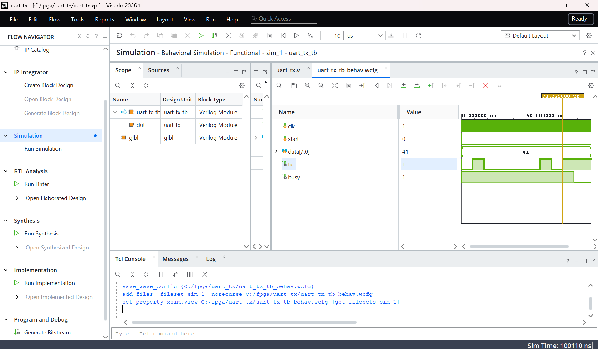

# FPGA UART Data Logger

A UART data logger on a Digilent Nexys A7-50T (Artix-7) FPGA, written in Verilog.
The FPGA packages input data into UART frames and streams it over USB to a PC,
where a Python script logs and plots it over time.

## Status
- [x] UART transmitter (Verilog finite state machine, 115200 baud from a 100 MHz clock)
- [x] Testbench, verified in Vivado behavioral simulation
- [ ] Top module: send the board's switch values once per second
- [ ] Run on hardware
- [ ] Python logger (pyserial, Pandas, Matplotlib)
- [ ] Onboard temperature sensor over I2C

## How it works
Each byte is sent as a 10-bit frame: a start bit (0), 8 data bits LSB first,
and a stop bit (1). The line idles high. At 115200 baud with a 100 MHz clock,
each bit lasts 868 clock cycles.

## Simulation
Sending the letter "A" (0x41). The tx line shows 0 | 1 0 0 0 0 0 1 0 | 1:

## Files
- `uart_tx.srcs/sources_1/new/uart_tx.v`: UART transmitter
- `uart_tx.srcs/sim_1/new/uart_tx_tb.v`: testbench

## Tools
Verilog, AMD Vivado 2026.1, Digilent Nexys A7-50T